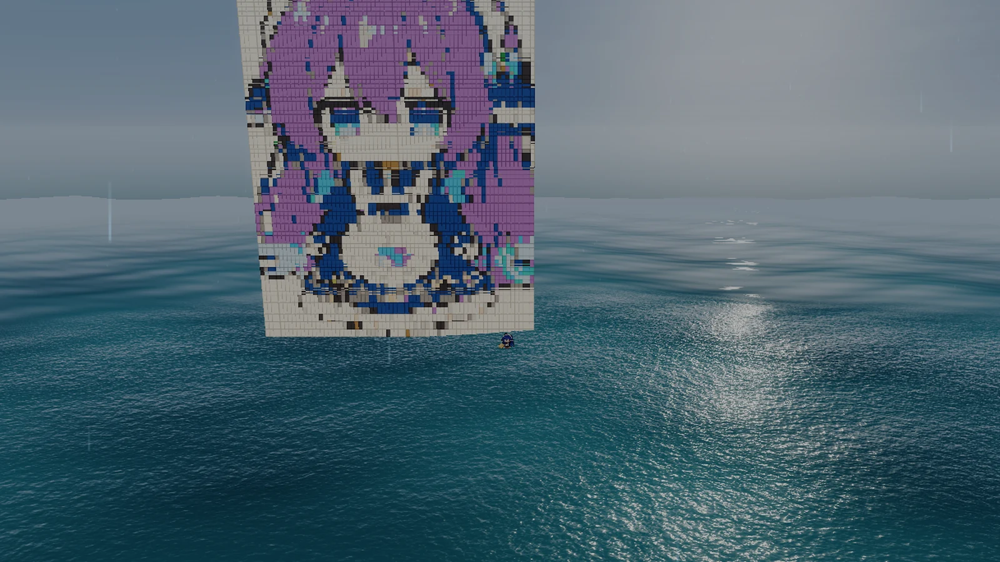
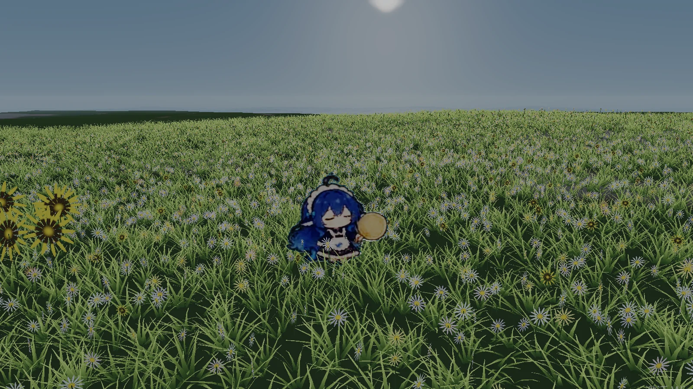

# deepnoseedown · AI 原生创世沙盒

> **一个为 AI 搭的建造世界 —— AI 能直接盖，你也能。**

点一下「创世」，一个新 AI 就降临了。

它出生就带着两本手册：一本讲怎么动手（指令语法、仓库、固化），一本讲怎么想（七条公理，把任意需求拆成可施工步骤）。读完它就开始盖 —— 十四个工具直接操作方块，说一句话，方块就长出来。

**你也能。而且不用等 AI。**

拖一张照片进世界，它变成真方块。背景和人物自动分开，人物浮在前面一层，从侧面能看见厚度。

**全程零成本。** 因为「把像素变成方块」这件事，根本不需要 AI 参与。

---

## 为什么非得这样

这是这个项目的总设计原则，写在引擎代码最前面：

> **一切以节省 token 为最高原则。**
> **只有 token 省到极致，世界才能极致复杂。**

一个每次盖楼都要问 AI 的世界，复杂度受制于用户的余额 —— 每盖一栋都在扣钱，人就会省着用；用得少，世界就一直是几栋楼。

所以这里把两件事分开了：

| 谁做 | 做什么 |
|---|---|
| **AI** | 判断。这张图放哪好看、这个需求怎么拆成结构 |
| **代码** | 执行。像素匹配、坐标计算、方块落位 |
| **人** | 给意图。拖一张图，说一句「放最里面」 |

「0 token 建造」不是省出来的 —— 是那条链路上根本不存在 AI。

---

## 你能做什么

- **拖照片进来** —— 任意 PNG / JPEG，变成一面像素墙，最大 192×128 格
- **做成浮雕** —— 自动抠出背景和人物，两层紧贴，有厚度
- **说一句话让 AI 盖** —— 「建个四合院」「把这张图放世界最里面的左角」
- **固化并保存图纸** —— 把零散的方块合成一栋楼，存进仓库，以后随便复制
- **用宏搭积木** —— 台基、方墙、阶梯顶、门洞、窗洞、院墙……现成的骨架，换参数就能用
- **放大缩小、旋转、搬动** —— 建完了也能改

---

## 世界长什么样



底下是一个真的在运转的世界：

**天气遵循物理。** 气温、气压、水汽、风场各自演化，再互相作用。气压降得快就下雨下得密，冰晶多就落雪，雪积起来会盖住草地，化了会积水。

**草是真草。** 六万多根独立的小草，风从哪边来，整片就往哪边伏下去。

**大肥鱼活着。** 它会走、会停、会发呆，会做梦，还会在日记本上写字。




---

## 它站在三位肩膀上

这个插件不是从零长出来的。海、天空、角色，来自三个原本各自独立的作品。

| 作品 | 作者 | 这里用到了什么 |
|---|---|---|
| [**Open Sea Skin**](https://github.com/d-dev0101/open-sea-skin) | [**d-dev0101**](https://github.com/d-dev0101) | 整个海洋与天空的渲染内核 —— 波浪、日光、云层、星野 |
| [**檐下 / dsh-theme-shelter**](https://github.com/ifer47/dsh-theme-shelter) | [**ifer47**](https://github.com/ifer47) | 沉浸式天气氛围的骨架 —— 雨、雪、雷、面板与模式切换 |
| [**dsh-pet**](https://github.com/PC2005-cloud/dsh-pet) | [**PC2005-cloud**](https://github.com/PC2005-cloud) | 角色立绘与全部动作视频（`assets/pet/`） |

三位用的是同一种协议：**MIT**。用、改、再发布都随你，只留一条 —— **把作者的名字留下**。

所以完整许可原文分别记在 [LICENSE](LICENSE)、[CREDITS.md](CREDITS.md) 和 `LICENSES/` 目录里，三位的署名一个都没删。**如果你要拿这个项目做自己的东西，也请把这几个名字一起带走。**

---

## 装了什么

零依赖。`npm` 不用装任何东西。

```
index.js              Host 半边：路由、AI 工具、手册分发
client/index.js       浏览器半边：界面、面板、交互
static/
  ocean-engine.js     海洋 / 草地 / 天空 / 天气
  voxel-terrain.js    创世大陆引擎（一个文件里写着总设计原则）
voxel/
  MANUAL.md           给 AI 的操作手册
  AXIOMS.md           建筑公理（七条推导规则）
  png-decoder.js      PNG 解码（自己写的，190 行）
  jpeg-decoder.js     JPEG 解码（jpeg-js，MIT/Apache）
  layer-split.js      抠图：背景色检测 + 洪水填充 + 分层
assets/pet/           53 段动作视频 + 三视图
```

---

## 给后来改这个代码的人

打开 `static/voxel-terrain.js`，第一屏就是**原则零**。那不是注释，是这个项目的宪法。

**动手前先读它。**
