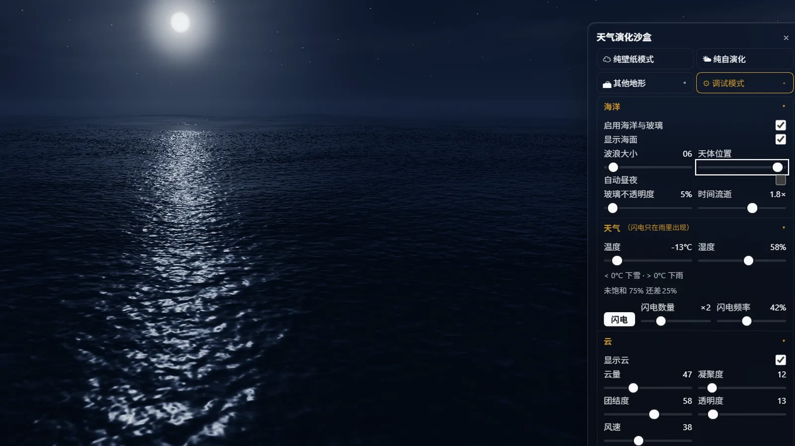

# 天气演化沙盒

> 一个会自己变天气的小世界。

## 站在这三位肩膀上

这个插件不是从零长出来的。它的海、它的天空、它的角色，来自三个原本各自独立的作品。

**感谢他们把这些放到 MIT 协议下，让后来的人可以接着往下做。**

| 作品 | 作者 | 这里用到了什么 |
|---|---|---|
| [**Open Sea Skin**](https://github.com/d-dev0101/open-sea-skin) | [**d-dev0101**](https://github.com/d-dev0101) | 整个海洋与天空的渲染内核 —— 波浪、日光、云层、星野，都是从这里起步的 |
| [**檐下 / dsh-theme-shelter**](https://github.com/ifer47/dsh-theme-shelter) | [**ifer47**](https://github.com/ifer47) | 沉浸式天气氛围的骨架 —— 雨、雪、雷、面板与模式切换的原始设计 |
| [**dsh-pet**](https://github.com/PC2005-cloud/dsh-pet) | [**PC2005-cloud**](https://github.com/PC2005-cloud) | 角色立绘与全部动作视频（`assets/pet/`）—— 立绘切成三视图去了白底，50 个动作重压到 256×144 |

三位用的是同一种协议：**MIT**。

> 用、改、再发布，都随你。只留一条——**把作者的名字留下**。

这本书也得守这条规矩，所以：完整许可原文分别记在 [LICENSE](LICENSE)、
[CREDITS.md](CREDITS.md) 和 `LICENSES/` 目录里，三位的署名一个都没删。

**如果你要拿这个项目去做自己的东西，也请把这几个名字一起带走。**

---

打开它，你会看到一片海。太阳会升起来，云会飘过去，草会跟着风摆——而且这一切都不用你管。

---

## 它是什么

这不是一张壁纸。

壁纸是死的，它活着。

这里的云不是画上去的图案，是真的在长、在飘、在下雨。这里的草不是贴图，是六万多根独立的小草，风一吹整片跟着伏下去。这里的太阳位置是真的，你调一下时间，它就从东边升起来，把海面染成橙色。

更重要的是——**它有脾气**。

湿度高了会下雨，温度低了下雨变成下雪，雨停了地上会积水，天冷积雪会慢慢化掉、化成水渗进土里。你不管它，它自己也这么转着。

---

## 四个按钮，四种看法

打开面板，最上面是四格按钮。你想怎么看它，点哪个就行。

### ☁ 纯壁纸模式

所有按钮消失，只剩风景。

适合放一边当背景，工作、写代码、发呆的时候用。想看回来，按一下角落的小圆钮就回来了。

### 🌤 纯自演化

不用管它，让它自己玩。

点下去之后，温度会自己起伏，云会自己聚散，该下雨的时候下雨，该放晴的时候放晴。天空会从早到晚走一圈，云影在地上慢慢移。

放着不管，它自己能转很久。

### 🏔 其他地形

换一个地方站。

**目前开放的是「草地」**——一片真实生长的草原。草地密度、花密度、积雪、积水都能调。草会跟着风一片接一片地伏下去，花也被同一道风吹得歪向同一边。

> 这一个模块是还在长的地方。
> 目前只做了草地，**以后会陆续加入更多地形**——森林、雪原、沙漠、岩滩……每一片都该有自己的植被和脾气。
> 具体会做什么、什么时候做，还没定。但方向是这个方向。

### ⚙ 调试模式

给想细调的人。

展开之后是四组折叠项：**海洋 / 天气 / 云 / 光**。每一组里都是具体的滑杆——波浪多大、温度多少、云有多厚、太阳多亮。

不点开的话，它会一直收在下面，不占地方。

---

## 一些你可能想不到的细节

**风是真的从气压来的**

不是随机乱吹。气压高的地方往气压低的地方吹，云、草、花、海面、地上的云影——全部跟着同一阵风走。气压低的地方更容易下雨，这是真的气象学。

**雨和雪不会打架**

温度在 0°C 附近的时候，雨雪最容易「一秒下雨一秒下雪」。这里做了处理：温度会先被烫平，再带一点记忆——不会因为零点零几度的抖动就改主意。

**草浪是滚过去的**

不是整片草一起晃。是一道波从远处推过来，草一片接一片地伏下去，像真的风扫过麦田。

**影子是真的**

云飘过的时候，地上的草地会暗一块。那块阴影跟着云一起走。

---

## 调好了，记得存下来

面板底部有两个按钮：**设为默认** 和 **恢复默认**。

### 设为默认

**把你辛苦调出来的那套参数，固定下来。**

花半小时把温度、湿度、云量、草的密度都调到最顺眼的样子——按一下「设为默认」，这套参数就成了你的基准。

以后不管怎么乱调、重启多少次，按「恢复默认」就能立刻回到这一刻。

> 调出好看的天气不容易，别让它白调。

### 恢复默认

回到你上次「设为默认」的那一套。

如果从来没按过「设为默认」，它会回到插件的出厂设置。

草地面板左下角也有同样一对按钮，**那个只管草地那几项**——草地单独存，不会连海洋、天气一起覆盖掉。

---

## 怎么装

在 DSH 插件市场里搜索 **天气演化沙盒**（包名 `dsh-weather-sandbox`）安装即可。

装好之后，屏幕右下角会多一个小圆钮，点它就能打开控制面板。

---

## 关于代码

作者：**deepnoseedown**

写着玩的时候一直在想一件事：**能不能用更少的代码，做更多的事。**

所以这个插件遵循「最原则」：

- **最少的代码** —— 能一行写完的绝不写两行，能不引入依赖就绝不引入。整个插件零依赖。
- **最密的功能** —— 一片海、一层云、一片草、一整套天气循环，全都塞进一个文件里。
- **最有用的注释** —— 代码里留下的不是「这里做了什么」，而是「这里为什么这么做」和「这里踩过什么坑」。

因为我知道，下一个打开这个文件的人，多半是几个月后的我自己。

开源地址：[github.com/deepnoseedown](https://github.com/deepnoseedown)

---

## 最后

它不完美。

远处的草还有点糊，云的样子还能更真，闪电偶尔来得不太是时候。草地之外的其它地形，也还在路上。

但它活着。

有空的话，打开它，什么都别调，就看十分钟。

你会看见天气，自己找上门来。
